# Lab 00 - Building my home lab

> **Draft.** The steps and facts below come from my lab sessions. Screenshots, the journal details and the final wording will be added next.

## Summary

I built a small virtual company network in VMware Workstation Pro: a Windows Server, a Windows 11 client and an Ubuntu Server. The server and the client talk over a private internal network, which I proved with a ping test.

## Skills and tools

VMware Workstation Pro, Windows Server 2025, Windows 11, Ubuntu Server, static IP addressing, subnet masks, Windows Defender Firewall, SSH, snapshots.

**Dates:** November 3-5, 2026

## Environment

| VM | OS | vCPU | RAM | Disk | Network | IP address |
| --- | --- | --- | --- | --- | --- | --- |
| DC01 | Windows Server 2025 Standard Evaluation (Desktop Experience) | 2 | 4 GB | 60 GB NVMe | NAT + LAB-NET | 172.16.0.1/24 on LAB-NET |
| CLIENT01 | Windows 11 | 2 | 4 GB | 64 GB | LAB-NET | 172.16.0.10/24 |
| UBU01 | Ubuntu Server 26.04.1 LTS | 1 | 2 GB | 30 GB | NAT | DHCP from VMware NAT |

**Why two networks:** NAT gives the VMs internet access for updates and activation. LAB-NET is a private LAN segment that only the lab VMs can see, so lab traffic (and DHCP later) never reaches my home network.

## Steps

### 1. Prepared the host

- Checked which drive is the SSD, and created lab folders on it, so the lab VMs run fast and stay separate from my class VMs on the hard drive.
- Downloaded the Windows Server 2025 and Ubuntu Server ISOs.

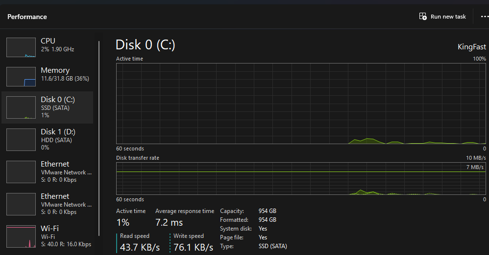
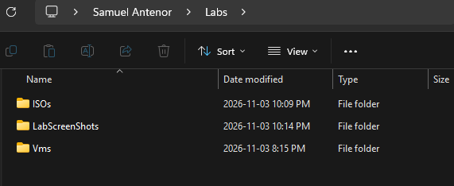

### 2. Built DC01 (Windows Server 2025)

- Created a custom VM: UEFI firmware, 2 cores, 4 GB RAM, 60 GB NVMe disk.
- Added a second network adapter on a LAN segment named LAB-NET.
- Installed Windows Server 2025 Standard Evaluation (Desktop Experience).
- Installed VMware Tools, renamed the adapters INTERNET and LAB, and renamed the computer DC01.
- Gave the LAB adapter a static IP: 172.16.0.1, mask 255.255.255.0, no gateway, DNS 127.0.0.1. A server needs a fixed address so clients can always find it.
- Enabled the inbound firewall rule "File and Printer Sharing (Echo Request - ICMPv4-In)" so the server answers ping.
- Ran Windows Update and checked activation with `slmgr /dlv`.

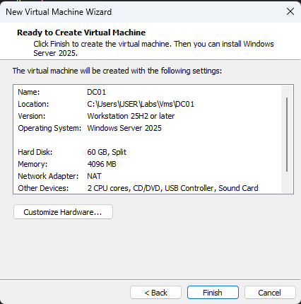
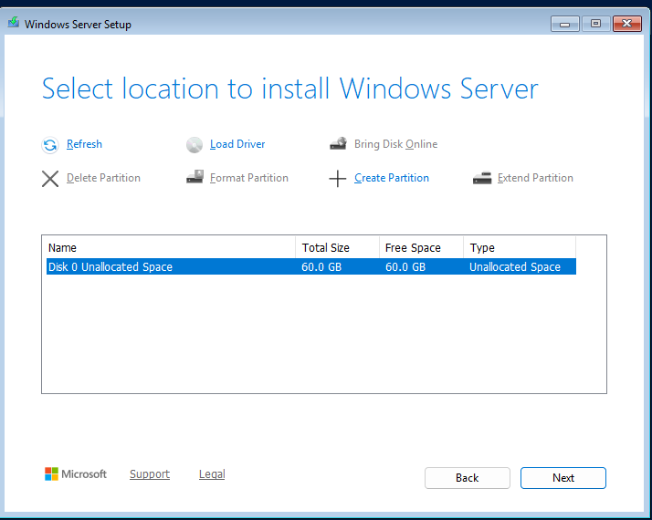
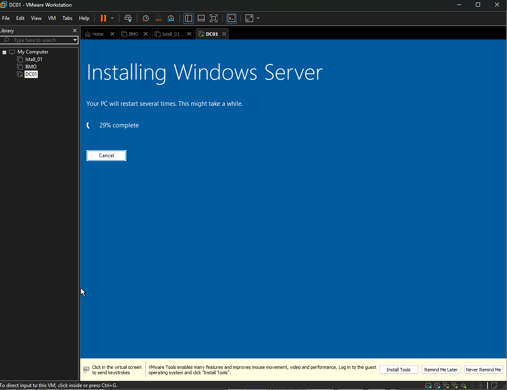
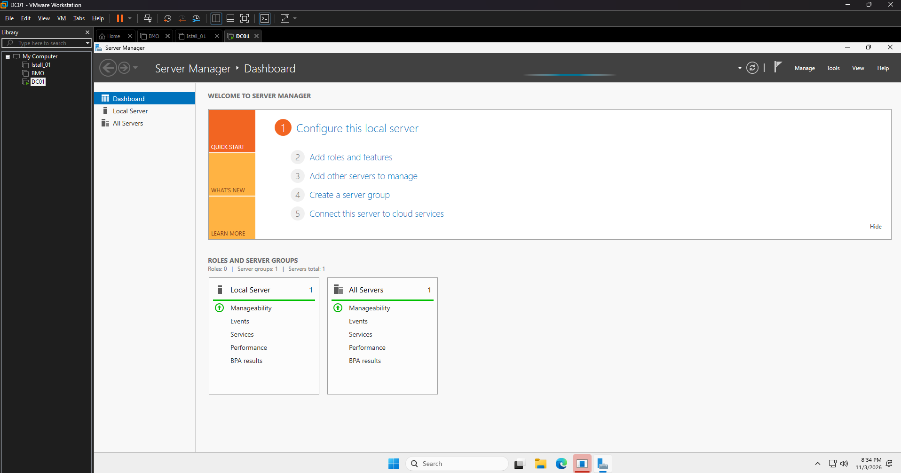
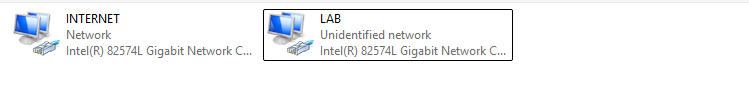
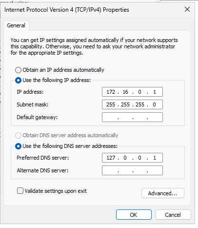
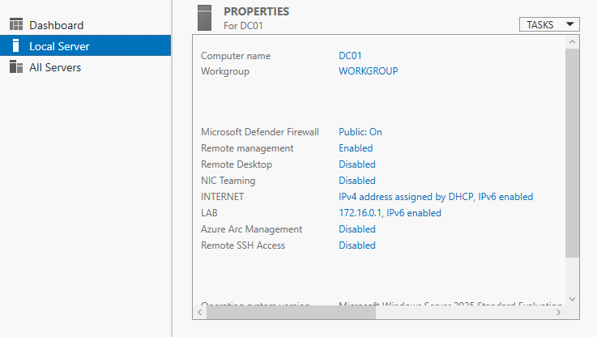
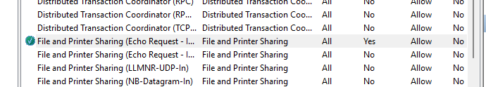

<!-- Missing screenshots: 04-dc01-hardware.png, 05-edition-selection.png, 12-activation.png -->

### 3. Built CLIENT01 (Windows 11)

- Created a Windows 11 VM with a virtual TPM, which Windows 11 requires.
- Installed Windows 11, VMware Tools and updates, and renamed it CLIENT01.
- Moved its network adapter to LAB-NET and set a static IP: 172.16.0.10, mask 255.255.255.0, gateway 172.16.0.1, DNS 172.16.0.1.

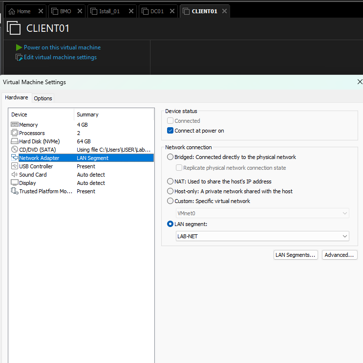

<!-- Missing screenshots: 14-win11-edition.png, 15-client01-static-ip.png -->

### 4. Built UBU01 (Ubuntu Server)

- Created an Ubuntu VM on the NAT network and installed Ubuntu Server 26.04.1 LTS with the OpenSSH server.
- Updated it with `sudo apt update && sudo apt upgrade -y`.
- Found its IP address with `ip a` and connected to it from Windows with `ssh`.

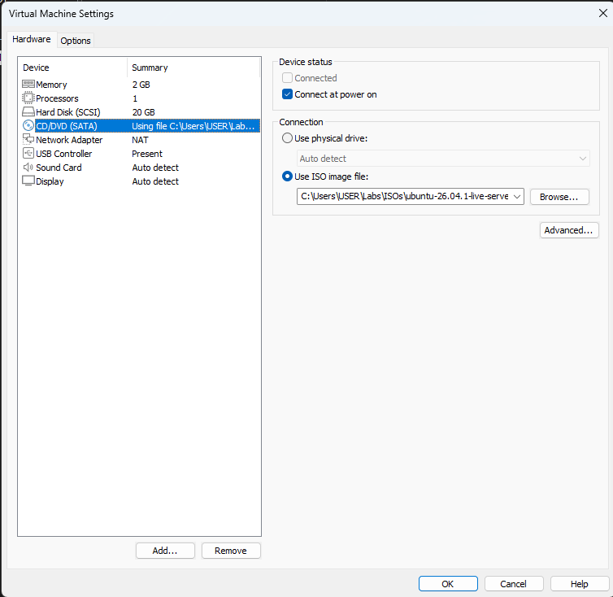
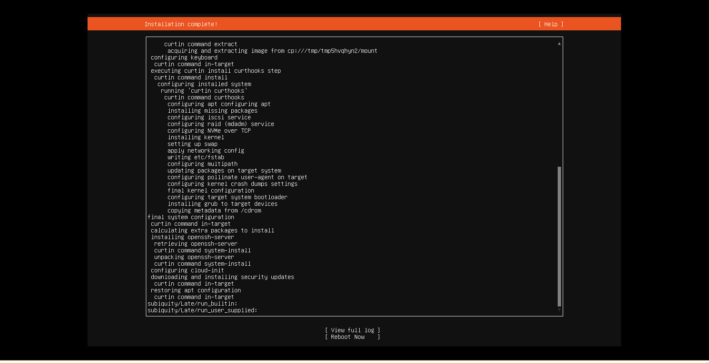
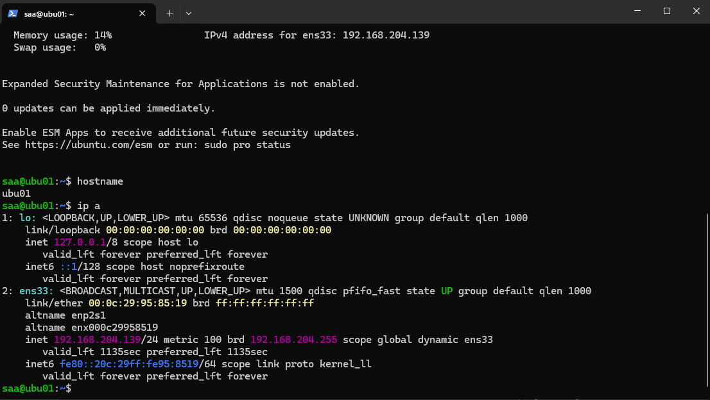
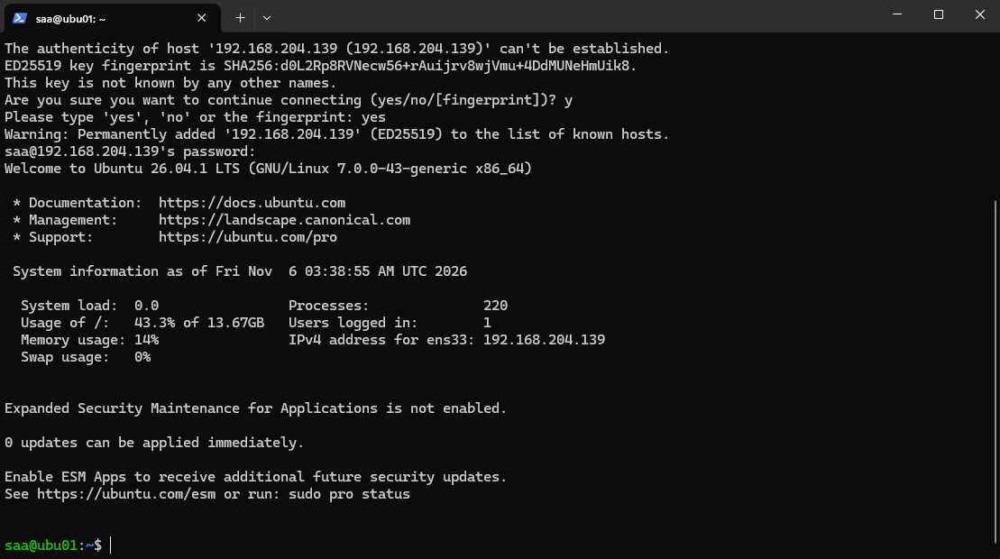

<!-- Missing screenshot: 19-ubuntu-ssh-option.png -->

### 5. Took snapshots

- DC01: `01-clean-install`
- CLIENT01: `01-lab-network`
- UBU01: `01-clean-install`

## Problems and fixes

| Problem | Cause | Fix |
| --- | --- | --- |
| Windows rejected the subnet mask: "The subnet mask has to be contiguous." | A leftover digit from the mask Windows filled in automatically. | Retyped all four boxes as 255.255.255.0 and checked them before clicking OK. |
| The Ubuntu installer failed at "installing kernel." | The 20 GB virtual disk was too small for this Ubuntu version. | Increased the virtual disk to 30 GB and reinstalled. |
| PowerShell said `shh` is not recognized. | A typo in the command name. | Used the correct command, `ssh`. |

<!-- Missing screenshots: 23-ubuntu-install-error.png, 24-ubu01-disk-resized-30gb.png -->

## Verification

- From CLIENT01, `ping 172.16.0.1` returned replies from DC01, which proves the LAB-NET network, both IP configurations and the firewall rule work.
- From Windows, `ssh` to UBU01 opened a remote session, and `hostname` returned `ubu01`.

<!-- To retake: 16-ipconfig.png (CLIENT01 showing 172.16.0.10), 17-ping-success.png (ping 172.16.0.1) -->

## What I learned

- An IP address is a machine's address, and the subnet mask defines its neighbourhood. Two machines talk directly only when they are in the same subnet; otherwise traffic goes through the default gateway.
- DNS works like a phone book that turns names into IP addresses. DC01 points to itself because it will run DNS in the next lab.
- Windows blocks ping by default, so a failed ping does not always mean the network is down.
- Reading the installer's error log pointed me to the real cause instead of guessing.

## Next steps

Lab 01: promote DC01 to a domain controller (Active Directory and DNS), then join CLIENT01 to the domain.

## Résumé en français

J'ai construit un petit réseau d'entreprise virtuel avec VMware Workstation Pro : un serveur Windows Server 2025, un poste client Windows 11 et un serveur Ubuntu. Le serveur et le client communiquent sur un réseau interne privé, ce que j'ai vérifié avec un test ping. J'ai aussi résolu une erreur de masque de sous-réseau et un échec d'installation d'Ubuntu causé par un disque virtuel trop petit.
